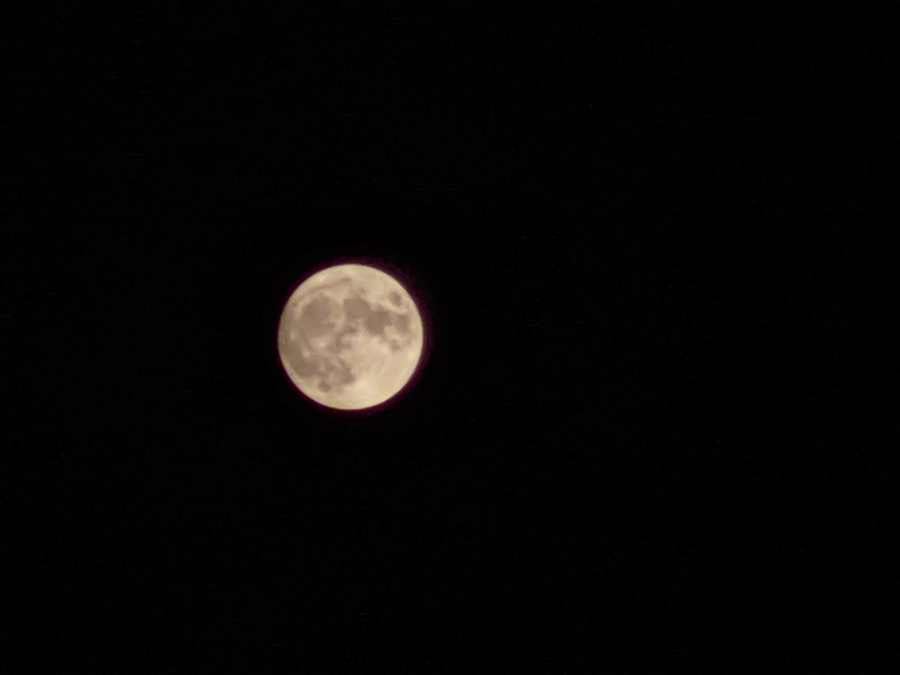
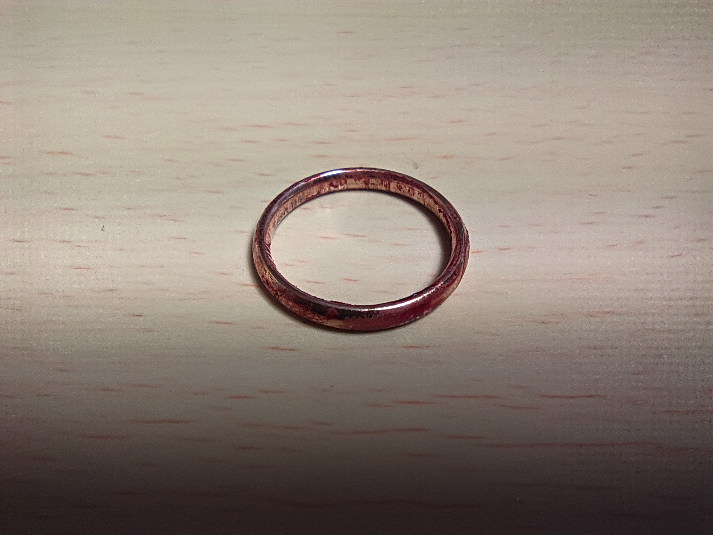
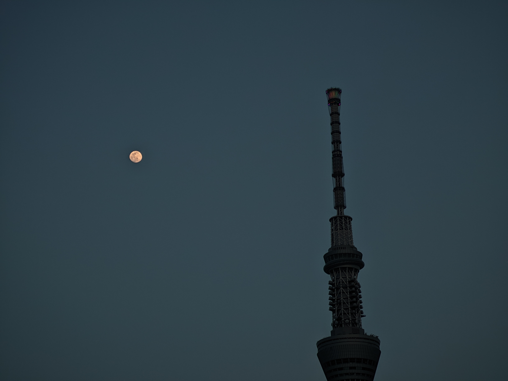
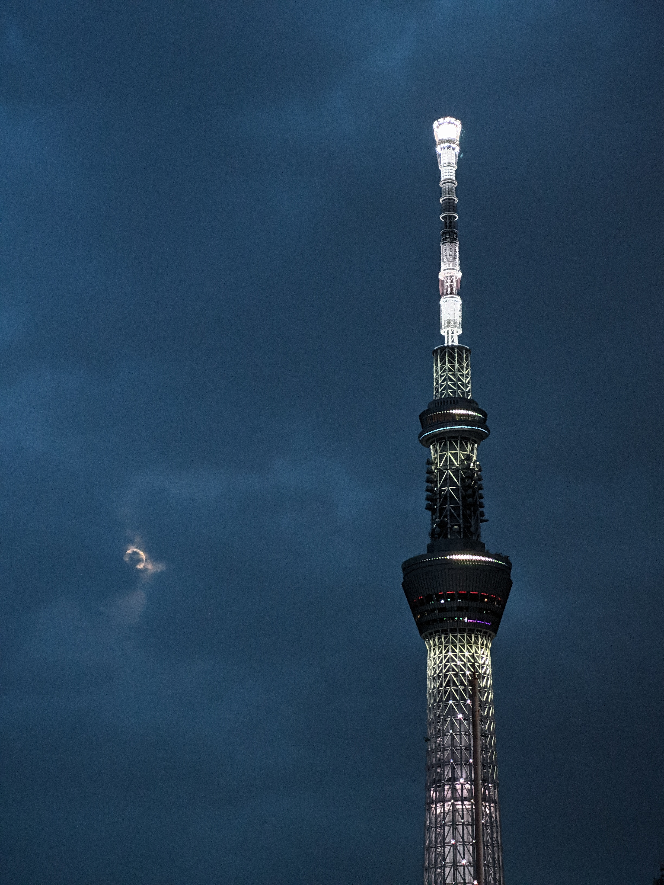
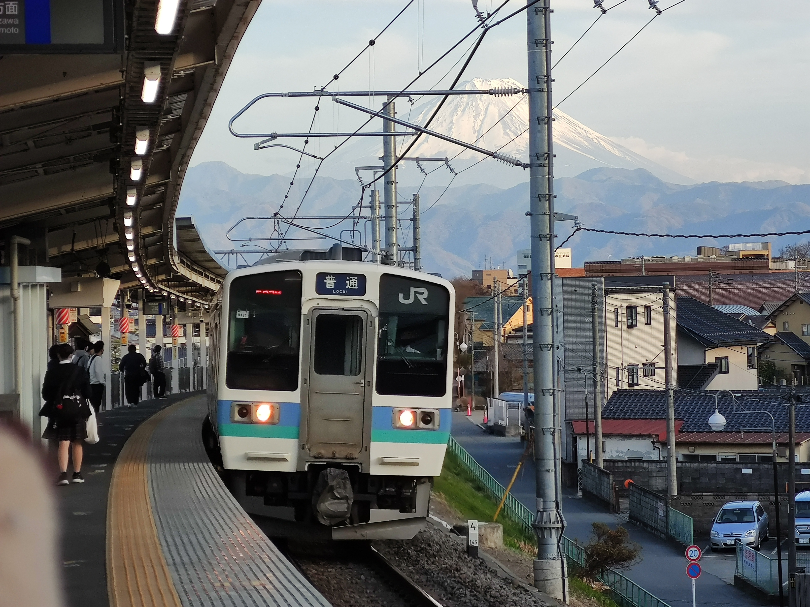
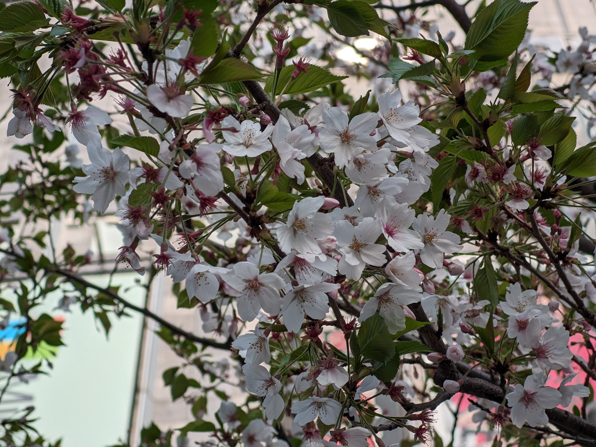
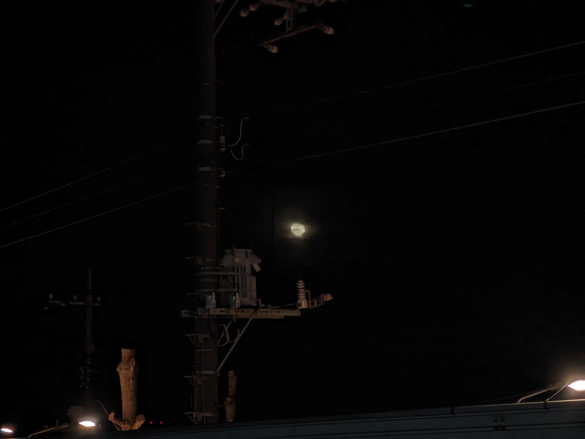

## 2020年

import { Image } from 'astro:assets';
import img1 from '../../../assets/images/posts/bestpictures-in-minote10/IMG_20200730_215453_2.jpg';

<figure>
  <Image src={img1} alt="" />
  <figcaption>マクロカメラで接写した水晶のブレスレット。</figcaption>
</figure>

月、これがこのスマホの限界。

import img2 from '../../../assets/images/posts/bestpictures-in-minote10/downscaled/IMG_20201221_140732_1.png';

<figure>
  <Image src={img2} alt="" />
  <figcaption>マグカップのココア</figcaption>
</figure>

[浅草駅のたぶんサンマルク](https://maps.app.goo.gl/mwGuiHmi5LfZvGGV9)だったかな

## 2021年

import img3 from '../../../assets/images/posts/bestpictures-in-minote10/downscaled/IMG_20210301_152934-edited.avif';

<figure>
  <Image
    src={img3}
    alt="桜の木々を背景に左向きの青いプジョー206が駐車されている様子をややローアングルから"
  />
  <figcaption>桜とプジョー206</figcaption>
</figure>

import img4 from '../../../assets/images/posts/bestpictures-in-minote10/IMG_20210301_154143_onFire.jpg';

<figure>
  <Image alt="桜の花びら" src={img4} />
  <figcaption>2倍テレフォトカメラ、ピンぼけしちゃっているのが残念</figcaption>
</figure>

[撮影スポットのGoogleマップのストリートビュー](https://www.google.com/maps/@34.916324,137.8083556,3a,75y,266.85h,94.84t/data=!3m7!1e1!3m5!1su8O6yo4qcSTZTeJs4UpnMg!2e0!6shttps:%2F%2Fstreetviewpixels-pa.googleapis.com%2Fv1%2Fthumbnail%3Fcb_client%3Dmaps_sv.tactile%26w%3D900%26h%3D600%26pitch%3D-4.837703347086105%26panoid%3Du8O6yo4qcSTZTeJs4UpnMg%26yaw%3D266.84541388419825!7i16384!8i8192?entry=ttu&g_ep=EgoyMDI2MDUyNy4wIKXMDSoASAFQAw%3D%3D)

赤と黄色の電車
地下鉄博物館

import img5 from '../../../assets/images/posts/bestpictures-in-minote10/downscaled/IMG_20210620_142212.avif';

<figure>
  <Image src={img5} alt="羽田空港の展望台から見た滑走路、手前には駐機している飛行機も見える" />
  <figcaption>羽田空港</figcaption>
</figure>

[ニコニコ動画 / 羽田空港　飛行機が着陸するところ](https://www.nicovideo.jp/watch/sm39824802)

🗻静岡県固有の山、マウントフジ
サービスエリアのスターバックスで飲み物を買って出たらちょうどいい景色が広がっていたので。

撮影場所: [Googleマップ / 富士川サービスエリア](https://maps.app.goo.gl/bVb1L1tSbeKMUQ526)

東京駅、丸の内口

夜の神社

## 2022年

import img19 from '../../../assets/images/posts/bestpictures-in-minote10/IMG_20220204_154225.jpg';

<figure>
  <Image src={img19} alt="" />
  <figcaption></figcaption>
</figure>

ベストショットというわけでもないけど、バイクで「44-44」ナンバーはかなりめずらしかったから…
バイクだと希望ナンバーは(撮影時点の2022年2月4日は)できないのでこれを引き当てるのは豪運に他ならない。
https://gemini.google.com/share/f7127ee97ceb

import img14 from '../../../assets/images/posts/bestpictures-in-minote10/downscaled/IMG_20220107_171131.avif';

<figure>
  <Image src={img14} alt="夕暮れ時の高層ビル群を背景に、タクシー乗り場で待機する2台の黒いタクシー。" />
  <figcaption>東京駅 丸の内 南口</figcaption>
</figure>

import img20 from '../../../assets/images/posts/bestpictures-in-minote10/downscaled/IMG_20220205_182644.avif';
import img21 from '../../../assets/images/posts/bestpictures-in-minote10/downscaled/IMG_20220205_180800.avif';

  <figure>
    <Image src={img20} alt="" widths={[3008, 2256]} class="rounded-lg" />
    <figcaption>ポテトバスケット</figcaption>
  </figure>
  <figure>
    <Image src={img21} alt="" widths={[3008, 2256]} class="rounded-lg" />
    <figcaption>ルビーチョコレートのミニシロノワール</figcaption>
  </figure>

沙都子がコメダに来た

星乃珈琲店
甘くておいしかったよ

import img6 from '../../../assets/images/posts/bestpictures-in-minote10/downscaled/IMG_20220701_190925.avif';

<figure>
  <Image src={img6} alt="" />
  <figcaption>さわやかのハンバーグ</figcaption>
</figure>

import img13 from '../../../assets/images/posts/bestpictures-in-minote10/IMG_20221125_162929.jpg';

<figure>
  <Image src={img13} alt="" />
  <figcaption>夕暮れのアクアラインからの富士山</figcaption>
</figure>

撮影場所: [Googleマップ / 海ほたるPA](https://maps.app.goo.gl/AzLxdeQdntsiXwc47)

## 2023年

でんちゃ
ルナちゃんのワゴンR(俗称: ワゴナール)での最後のまともな思い出となった穂高旅行の1枚。

import img16 from '../../../assets/images/posts/bestpictures-in-minote10/IMG_20230331_144253.jpg';
import img17 from '../../../assets/images/posts/bestpictures-in-minote10/IMG_20230331_145146.jpg';
import img18 from '../../../assets/images/posts/bestpictures-in-minote10/IMG_20230331_145303.jpg';

<figure>
  <Image src={img16} alt="草原の中に佇む白黒猫" />
  <figcaption>ドヤ顔にゃんにゃ</figcaption>
</figure>

<Image src={img17} alt="木の枝にとまる2羽の鳩" />

<Image src={img18} alt="三分咲きの桜" />

import img12 from '../../../assets/images/posts/bestpictures-in-minote10/downscaled/IMG_20231002_144221880.avif';

<figure>
  <Image src={img12} alt="駅の連絡橋の窓から見る水平線、下はプラットフォームと電車、上は青空と雲" />
  <figcaption>東海道本線 島田駅</figcaption>
</figure>

まぼろしへと送り出す新幹線

それがあった場所

私を貫く蛍光線

かつての思い出の喫茶店は眠っていた
夢だったのかな

![IMG_20231004_112938.jpg]
現実へと連れて帰る新幹線、ひかり500号

import img8 from '../../../assets/images/posts/bestpictures-in-minote10/downscaled/IMG_20231110_155437658.avif';

<figure>
  <Image
    src={img8}
    alt="お茶の水・聖橋付近から見た神田川と鉄道の都市景観。ツタに覆われた高架線路を走るJR中央線快速電車と、その背後に広がる高層ビル群。"
  />
  <figcaption>御茶ノ水</figcaption>
</figure>

手前に柵を含めたのは失敗か？
でも乗り出して撮影するのは落としそうで怖い。

import img9 from '../../../assets/images/posts/bestpictures-in-minote10/downscaled/IMG_20231110_172816102.avif';

<figure>
  <Image src={img9} alt="夜の眩しい秋葉原、ヨドバシカメラの建物" />
  <figcaption>あきばヨドバシ</figcaption>
</figure>

これはGCamでの撮影のはずだけど夜空が露出過剰かも…(Gcamあるある)

## 2024年

import img15 from '../../../assets/images/posts/bestpictures-in-minote10/IMG_20240202_125947.jpg'

<figure>
  <Image src={img15} alt="2羽で寄り添う鳩" />
  <figcaption>イチャイチャしやがって</figcaption>
</figure>

秋葉原で撮った桜。

## 2025年

えー、こちらがGeForce RTX 5090争奪戦の現場となった秋葉原のパソコン工房と[看板を破壊された例の幼稚園](https://maps.app.goo.gl/ScY8YabUgfKWqq3p8)になります。
これ1枚目に映っているのはアウトレット館なんですけど、たぶん更に手前側にあった本店からずっと列が伸びていたんだと思います。

import nyainshutain from '../../../assets/images/posts/bestpictures-in-minote10/downscaled/IMG_20250714_224056.avif';
import nyainshutain_inspyrenet from '../../../assets/images/posts/bestpictures-in-minote10/downscaled/nyainshutain-untransparent.avif';

  <figure>
    <Image src={nyainshutain} alt="こちらを向いて舌を突き出す猫" widths={[3008, 2256]} class="rounded-lg" />
    <figcaption>アインシュタイン</figcaption>
  </figure>
  <figure>
    <Image src={nyainshutain_inspyrenet} alt="それを背景除去したフリー素材" widths={[3008, 2256]} class="rounded-lg" />
    <figcaption>InSPyReNetを使ったら一発で切り抜きできた</figcaption>
  </figure>

[というわけで透過JPEG XL形式で置いておきます。](/images/jxl/nyainshutain.jxl)

import moon1 from '../../../assets/images/posts/bestpictures-in-minote10/IMG_20250908_013526.jpg'
import moon2 from '../../../assets/images/posts/bestpictures-in-minote10/IMG_20250908_022641.jpg'
import moon3 from '../../../assets/images/posts/bestpictures-in-minote10/IMG_20250908_033959.jpg'

  <Image src={moon1} alt="" widths={[2592, 1944]} class="rounded-lg" />
  <Image src={moon2} alt="" widths={[2592, 1944]} class="rounded-lg" />
  <Image src={moon3} alt="" widths={[2592, 1944]} class="rounded-lg" />

2025年9月8日の皆既月食。

import img_shinjuku1 from '../../../assets/images/posts/bestpictures-in-minote10/downscaled/IMG_20250909_161242.avif'
import img_shinjuku2 from '../../../assets/images/posts/bestpictures-in-minote10/downscaled/IMG_20250909_164159.avif'

<figure>
  <Image src={img_shinjuku1} alt="" />
  <figcaption>東京都庁</figcaption>
</figure>

なぜかここに掲載すると上下が見切れてしまっていい写真じゃなくなってしまってます。

<figure>
  <Image src={img_shinjuku2} alt="" />
  <figcaption>展望台からの景色</figcaption>
</figure>

## 2026年

このスマホがメインだった最後の年になります。

import img7 from '../../../assets/images/posts/bestpictures-in-minote10/downscaled/PXL_20260106_123547980.avif';

<figure>
  <Image src={img7} alt="仙台のマクドナルドとすき家が合体した店舗" />
  <figcaption>最も牛への敬意がない場所</figcaption>
</figure>

[撮影スポットのGoogleマップのストリートビュー](https://www.google.com/maps/@38.2614968,140.8771924,3a,75y,156.91h,95.07t/data=!3m7!1e1!3m5!1szT9u45A3I3n6EeFeCt-ncg!2e0!6shttps:%2F%2Fstreetviewpixels-pa.googleapis.com%2Fv1%2Fthumbnail%3Fcb_client%3Dmaps_sv.tactile%26w%3D900%26h%3D600%26pitch%3D-5.070691669193252%26panoid%3DzT9u45A3I3n6EeFeCt-ncg%26yaw%3D156.907886446471!7i13312!8i6656?entry=ttu&g_ep=EgoyMDI2MDUyNy4wIKXMDSoASAFQAw%3D%3D)

元ネタ

- https://x.com/BANGBANGsendai/status/2042901849712574936 [(Nitter)](https://nitter.net/BANGBANGsendai/status/2042901849712574936)
- https://x.com/oz_tomoki/status/1520973962196373504 [(Nitter)](https://nitter.net/)

[なお、バズらなかった模様](https://x.com/ame_youjo/status/2008866156623634537)([Nitter](https://nitter.net/ame_youjo/status/2008867729978356188))

この3日前の2026年3月3日に皆既月食があったんだけど忘れてたっていう…

import img10 from '../../../assets/images/posts/bestpictures-in-minote10/downscaled/PXL_20260323_165451839.avif';

<figure>
  <Image src={img10} alt="土に咲かされる花" />
  <figcaption>JR秋葉原駅 電気街北口</figcaption>
</figure>

import img11 from '../../../assets/images/posts/bestpictures-in-minote10/downscaled/IMG_20250917_161117.avif';

<figure>
  <Image src={img11} alt="" />
  <figcaption>みほみんの橋</figcaption>
</figure>

「みほみん橋」ではなく「みほみんの橋」が正式みたい[^bridge-of-mihomin-1][^bridge-of-mihomin-2]

[^bridge-of-mihomin-1]: https://x.com/charon_kn/status/1775139247638651078
[^bridge-of-mihomin-2]: https://x.com/charon_kn/status/1647971952974516226

んー、でも屈したのか2025年には「みほみん橋」と言っている…[^bridge-of-mihomin-3]
どっちでもいいのかな

[^bridge-of-mihomin-3]: https://x.com/charon_kn/status/1901152158676025721

## おわり

きれいな写真をいっぱいありがとう
2019年に4万7000円で発売されたこのスマホのカメラはすごかった
6年間ありがとう
いまだにこのスマホで撮った写真は色褪せない

### トリビア

あ、この記事を書いたの自分です。
https://wikiwiki.jp/xiaomi/Mi%20Note%2010

---
